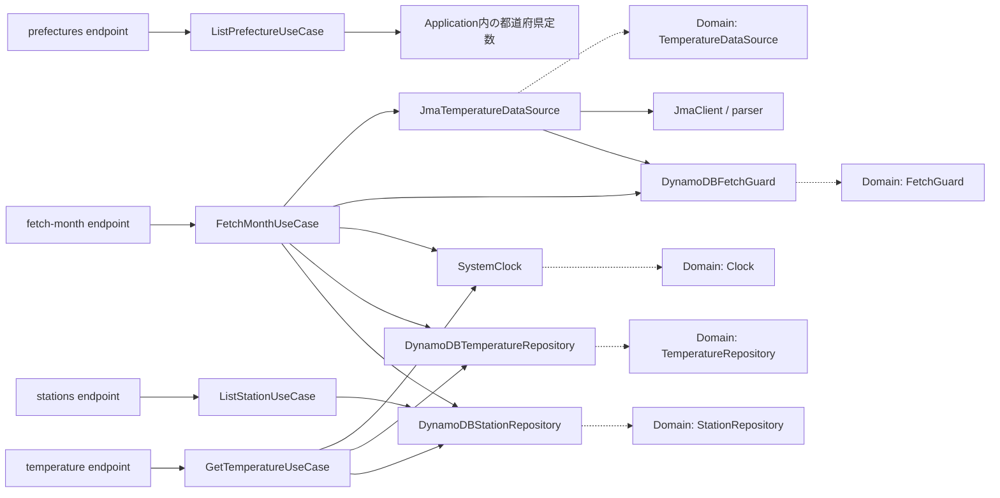
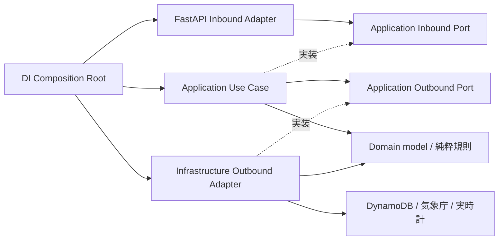

# バックエンドのPort／Adapter設計

エンジニア向けに、APIを維持してApplication所有のPortへ段階移行する設計を定義する。
設計の基準は2026-10-21の`eb5d792`、親Issueは[#137][parent]、設計Issueは[#153][design]。
本設計の追加時点ではアプリケーションコードを変更していない。以下の「目標」は後続Issueで実装する契約である。
利用者向け仕様は[プロダクト仕様][product]、検証層は[テスト戦略][testing]を正本とする。

## 現行の経路と依存

次図の実線は呼び出し、点線は型への依存を表す。各endpointはDIが公開する具象Use Case型の`Annotated` aliasをimportしている。



| 現行の所有物 | 利用元と問題 | 目標・移送する段階 |
| --- | --- | --- |
| `domain/station/repository.py`: `StationRepository` | stationと両temperature Use Caseが利用 | `application/station/ports/outbound/repository.py`、#156 |
| `domain/temperature/repository.py`: `TemperatureRepository` | 両temperature Use Caseが利用 | `application/temperature/ports/outbound/repository.py`、#157 |
| `domain/temperature/data_source.py`: `TemperatureDataSource` | FetchMonthUseCaseが利用 | `application/temperature/ports/outbound/data_source.py`、#158 |
| `domain/time/clock.py`: `Clock` | 両temperature Use Case、Repository、Guardが利用 | `application/shared/ports/outbound/clock.py`、#157 |
| `domain/temperature/fetch_guard.py`: `FetchGuard` / `FetchUnavailable` | FetchMonthUseCase、JMA Adapter、Guard、endpointが利用 | Outbound契約は`application/temperature/ports/outbound/fetch_guard.py`、#158。HTTPへ出すエラー契約はInbound側 |
| `di/container.py`: 4つの`*UseCaseDep` | endpointが具象Use Caseへ間接依存 | 各経路でPort型のPresentation依存関数へ置換、#159で旧alias撤去を確認 |
| Use Caseファイル内の`*Output` dataclass | Use Case具象と出力契約の所有が同じ | 経路ごとの`ports/inbound/`へ移送 |
| `main.py` / `handler.py`のseed・init呼び出し | mainはtable初期化とseed、Lambdaはimport時seed、Mangumはlifespan off | #159でDIの初期化関数へ委譲。回数・タイミング・起動経路は維持 |

純粋な`FetchFreshnessPolicy`、`FetchStatus`、`observation_time`、観測年月の検証、モデルはDomainに残す。
`InvalidTemperatureInput`は純粋な規則の例外としてDomainに残し、ApplicationがInboundの入力エラーへ変換する。
stationの未検出エラーも#156でstationのInbound契約へ定義し、現在の404とメッセージを維持する。
現在のtemperature endpointによるDomain例外importは#157/#158で除去する。
`/health`と`/api/hello`はI/OもUse Caseも持たない応答であり、空のInbound Portを作らない。

## 目標の所有と配置



呼び出しは`Inbound Adapter → Inbound Port ← Use Case → Outbound Port ← Outbound Adapter`で説明する。
Portの実装はPythonの構造的`Protocol`で表す。具象クラスの継承は必須にせず、DI providerのPort戻り値型とmypy strictで適合を検査する。
Application内では他機能のOutbound Portを利用できる。temperatureからstation Repositoryを利用する現行経路を維持する。

次は完成形の配置契約であり、空ディレクトリや未使用Protocolを先に作る指示ではない。

```text
app/
  application/
    prefecture/
      ports/inbound/list_prefecture.py  # ListPrefecturePort, PrefectureOutput
      list_prefecture_use_case.py
    station/
      ports/inbound/list_station.py     # ListStationPort, StationOutput
      ports/outbound/repository.py      # StationRepository
      list_station_use_case.py
    temperature/
      ports/inbound/get_temperature.py  # GetTemperaturePort, 取得専用Output群
      ports/inbound/fetch_month.py      # FetchMonthPort, 月別専用Output
      ports/inbound/errors.py           # 利用される入力不正・未検出・取得不可の契約
      ports/outbound/repository.py      # TemperatureRepository
      ports/outbound/data_source.py     # TemperatureDataSource
      ports/outbound/fetch_guard.py     # FetchGuard, FetchUnavailable
      get_temperature_use_case.py
      fetch_month_use_case.py
    shared/ports/outbound/clock.py      # Clock
  domain/                              # model, input_policy, fetch_freshness
  presentation/api/                    # endpoint別DTOとrouter
    shared/dependencies.py             # Port型付き依存関数、具象生成なし
  infrastructure/                      # repositories, scraper, DTO, time
  di/container.py                       # provider、依存登録、初期化と終了の配線
  main.py                               # ASGI起動、router/middleware登録
  handler.py                            # Lambda起動、Mangum
```

Inbound Portのメソッド名・同期／非同期・引数は現行Use Caseの公開メソッドを維持する。
`list_prefectures()`、`list_stations(prec_no=None)`、`get_temperature_data(station_id, end_year)`、
`async fetch_month(station_id, year, month)`を契約とし、単純な入力は標準型の引数で受ける。
複合入力が必要になるまではInput DTOを増やさない。OutputとPortを同じ契約モジュールに置き、Use Case具象のimportを不要にする。

### 禁止依存と例外

| import元 | 許可する内側の依存 | 禁止する依存 |
| --- | --- | --- |
| Domain | Domain、標準ライブラリ | Application、Presentation、Infrastructure、DI、設定、外部framework、外部I/O Protocol |
| Application | Application、Domain、標準ライブラリ（`asyncio`を含む） | Presentation、Infrastructure、DI、設定、FastAPI、Pydantic、boto3、httpx |
| Presentation | Application Inbound Portと公開入出力・例外 | Use Case具象、Outbound Port、Domain、Infrastructure、DI、設定 |
| Infrastructure | Application Outbound Port、Domain、Infrastructure、外部SDKと設定 | Inbound Port、Use Case具象、Presentation、DI |
| DI | Port、Use Case具象、Adapter、設定、Presentation依存関数 | 業務判断・HTTP応答への変換 |

Presentation内のHTTPライブラリ、DTO、補助関数、router集約は許可する。`main`は起動配線として設定、Presentation、DIを参照できる。
`handler`はmain、DI、Mangumを参照できる。これらを業務処理や任意の具象接続の逃げ道にしない。
Infrastructure内のparser・DTO変換などの部品利用は許可する。外部clientの生成とlifecycle方針はDIへ渡し、Adapterは渡されたclient/factoryを使う。
既存の`JmaClient`の取得ごとの生成・`finally`でのcloseを保つfactory配線とし、close責務を消したりアプリ全体共有へ変えたりしない。

移行中だけ、表の未移行経路に残る既存のDomain Port、DI alias、Domain例外参照を許可する。
#154で例外を具体的なファイル／import単位で固定し、移行PRで削減する。新規違反をディレクトリ単位で免除しない。
現行のAST検査はProtocolを想定しないUse Case命名検査と相対import解決の不足を持つため、#154で先に対応する。

### 入出力と例外の変換

- Inbound AdapterはHTTPのpath/queryを標準型へ検証し、Portへ渡す。ApplicationにFastAPIやPydanticを持ち込まない。
- Outbound AdapterはDynamoDB Item、HTMLなどをInfrastructure専用DTOで検証し、Domainモデルへ変換して返す。Portへ外部DTOを返さない。
- Use CaseはDomainモデルをユースケース専用Output dataclassへ明示変換する。OutputフィールドにもDomainモデルを公開しない。
- Inbound AdapterはOutputをendpoint専用のstrict Pydantic Responseへ明示変換する。日付、null、フィールド名、HTTP応答は維持する。
- 入力規則のDomain例外はUse CaseでInbound入力エラーへ変換し、未検出と区別する。取得制御のOutbound例外もInbound取得不可へ変換する。公開エラーのメッセージを保持する。
- HTTPへの対応はAdapterが行い、入力不正422、未検出404、取得不可503と`Retry-After: 5`、予期しない失敗500の既存契約を維持する。内部例外の詳細を新たに公開しない。

### Composition Rootとテスト差し替え

Presentation内の依存関数はInbound Portを戻り値に持ち、未登録時は明示的な構成エラーを起こす。
endpointは`Annotated[ListStationPort, Depends(...)]`のようにその関数を参照する。DIの具象型aliasを使わない。
DIは具象生成providerを用意し、FastAPI appのdependency overrideへ依存関数とproviderの対応を登録する。
mainがapp作成時に登録を呼び、Lambdaでも同じappの登録を利用する。Applicationはこの登録方式を知らない。
現行mainのグローバル500 handlerによるResponse DTO変換は#159でPresentationの補助関数へ移し、mainにはhandlerの登録だけを残す。ログと応答本文は維持する。
テストは同じPresentation依存関数をPort準拠fakeに差し替え、実施後にoverrideを復元する。DI具象providerを差し替え続けるfixtureは移行経路ごとに更新する。

ClockはUTC壁時計と単調増加時計を区別する。FetchGuardのlease取得・所有確認・試行間隔・releaseの責務を維持する。
同一取得でUse CaseとJMA Adapterが同じGuardを共有する配線を維持し、移送時に別instanceを作らない。

## 移行順と各マージ時点の状態

各段階は独立したPRで検証し、人のレビュー・マージ後の最新mainから次へ進む。
Domain Portの旧パスを全利用元・テストと同時に移送し、旧パス再exportによる恒久的な互換層を作らない。

| Issue | 変更とマージ時点の状態 | 維持を確認するもの |
| --- | --- | --- |
| #153 | 本設計、AGENTS、レビューガイド、READMEのみ。コードは現行のまま | 文書のリンク、実装との棚卸し整合 |
| #154 | 回帰テストとAST境界検査を準備。未移行の例外を固定 | 全公開API、相対／絶対importの負例、mypy、unit・integration |
| #155 | prefecture Inbound Port、Output移送、依存関数とDI登録の最小パターン。ほかは現行 | prefecture応答、既存ASGI/Lambda起動 |
| #156 | station Inbound/Outbound Port移行。temperature Use CaseもStationRepositoryの新importへ追従 | 全件／絞り込み、未検出、station DTO、DynamoDB契約 |
| #157 | temperature取得Inbound/Repository移行。Clockも全利用元ごと移送。fetch-monthの参照も追従 | 50年範囲、日付・空データ、未検出、入力不正、時刻と鮮度 |
| #158 | fetch-month Inbound/Data Source/Guard移行。Domainの外部I/O Protocolを解消 | キャッシュ、再取得、保存、lease、retry、budget、エラー契約 |
| #159 | DI/main/handlerの配線・client lifecycleを仕上げ、旧aliasと移行例外を撤去 | host UvicornとLambda/Mangum、初期化とtest override |
| #160 | 最新mainで最終統合確認、文書の現状記述を完成形へ更新 | 全API実HTTP、import負例、required checks、Browser Smoke、開発/Lambda image smoke |

#155〜#158の各PRで移行対象のUse Case・Adapterを接続するDIも同時に更新し、#159まで壊れた中間状態を残さない。
#158までにJMA Adapterのclient/factory注入を配線し、#159では残存する具象接続を全体検索する。
各経路の移行時にunit・integration・DTO・境界テストを更新し、backendのformat → import sort → lint → mypy strict → pytestを実行する。
Browser Smokeは固定API応答による画面回帰、host/image smokeは実行経路の確認として別々に扱う。
最終検証で対象commit、環境、結果と未確認範囲を#160へ記録する。本番デプロイは対象外である。

## 移行中の検査の運用（#154）

`backend/tests/layer_rules.py`は目標構成のimport規則を定義し、`test_layer_boundaries.py`が実appツリーへ適用する。
絶対import、兄弟層への相対import、`from . import ...`、`__init__.py`、alias、TYPE_CHECKING内を含む静的importをASTで解決する。
動的importや実行時の具象生成までは保証しない。具象接続とlifecycleは移行PRのレビュー・#159の検索・#160の起動検証で確認する。

- `MIGRATION_EXCEPTIONS`は#154開始時の既存違反15組を「ファイルとimport先」で固定する。新規違反と、解消済みなのに残った例外の両方を失敗にする。
- `DOMAIN_PROTOCOL_EXCEPTIONS`は残る5つのDomain Protocol定義を固定し、別名や修飾名でのProtocol追加も検出する。
- 各移行PRでは経路のコード・テストと同時に対応する例外だけを削除する。例外一覧を現物から再生成して新規違反を容認しない。
- `application/<feature>/ports/`の契約クラスはUse Case/Service命名検査の対象外とし、Port配置と依存方向で検査する。Use Case自身の単一公開メソッド検査は維持する。
- `test_layer_rule_guards.py`は一時Pythonファイルへの禁止import配置と正例を自動検証する。appツリーへの絶対／相対禁止import配置でも境界pytestが終了コード1となり、除去後に成功することを#154で確認した。

API回帰の基準は`backend/integration_tests/api/`に置く。外部気象取得だけをfakeへ置換し、FastAPI、Use Case、DynamoDB RepositoryとDynamoDB Localを通す。

| 経路 | 現行テストと#154で固定する契約 |
| --- | --- |
| health / hello | 成功時の正確な本文 |
| prefectures | 61件、公開フィールド、型、東京都の名称 |
| stations | 全件と絞り込み、正確な公開フィールド・値、未検出404、型不正422 |
| temperature | 空・保存済みデータ、50年窓、最古年と次区間なし、日付・null、未検出404、観測年／HTTP入力不正422 |
| fetch-month | 正確な取得応答、キャッシュ、保存副作用、入力不正／未検出、上流RuntimeError/TimeoutErrorの503・Retry-After、予期しないOSErrorの500 |

上流失敗時は内部メッセージを応答へ出さず、取得済みログを残さず、lease解放後に再試行が成功することも検査する。
既存のunit・DTO・lease検査を維持し、#154はアプリケーションコードやAPI仕様を変更しない。

## prefecture移行の最小パターン（#155）

prefecture一覧では以下の構成を実装した。station・temperatureは移行前の経路を維持する。

1. `application/prefecture/ports/inbound/list_prefecture.py`が`ListPrefecturePort`と`PrefectureOutput`を所有する。メソッドは引数なしの`list_prefectures()`で、未使用のInput DTOやOutbound Portは作らない。
2. `ListPrefectureUseCase`は契約モジュールのOutputを返す。構造的Protocolへの適合はDI providerの`ListPrefecturePort`戻り値型とmypy strictで確認する。
3. `presentation/api/shared/dependencies.py`の`get_prefecture_port()`はPortを返す依存関数で、未登録なら構成エラーを送出する。
4. endpointは`Annotated[ListPrefecturePort, Depends(get_prefecture_port)]`で受け、専用のstrict `PrefectureResponse`へ明示変換する。具象Use Case・DIをimportしない。
5. `di/container.py`の`register_dependencies(app)`が依存関数とproviderを登録する。mainはapp作成直後に呼ぶので、lifespanを使わないLambda/Mangumにも同じ配線が適用される。
6. テストはPresentationの依存関数をPort準拠fakeへ差し替える。共有appのoverrideとlifespanを変更するfixture・テストは、終了時に保存した元の状態を復元する。登録全体の消去で本来のDI配線を失わない。

prefectureの旧具象型aliasを削除し、対応するimport移行例外1組を除去した。残る例外はほかの経路を移行するときに減らす。
unitではカタログ・順序、空／複数要素のPort差し替え、実provider登録、未登録エラー、Lambdaのlifespan off経路を検証する。
integrationでは既存の61件・フィールド・東京都の応答契約を維持する。

<!-- links -->
[parent]: https://github.com/nkoguchi-dev/heat-chronicle/issues/137
[design]: https://github.com/nkoguchi-dev/heat-chronicle/issues/153
[product]: ./specs/product.md
[testing]: ./TESTING_STRATEGY.md
<!-- /links -->
