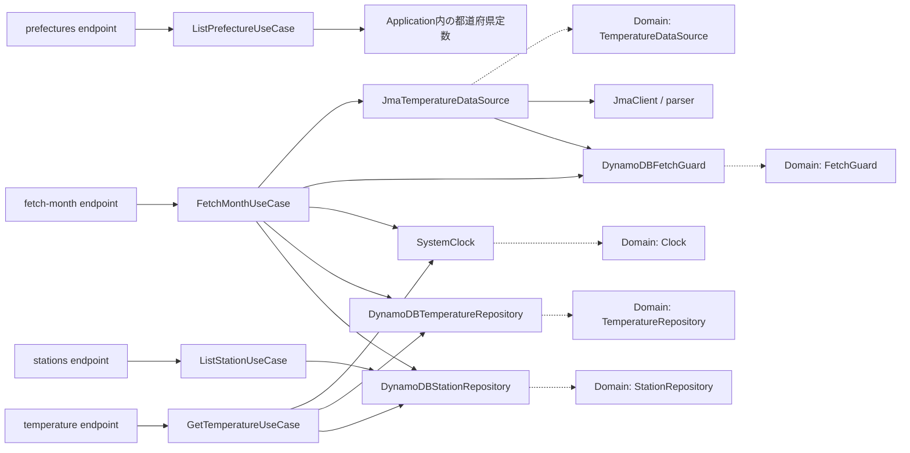
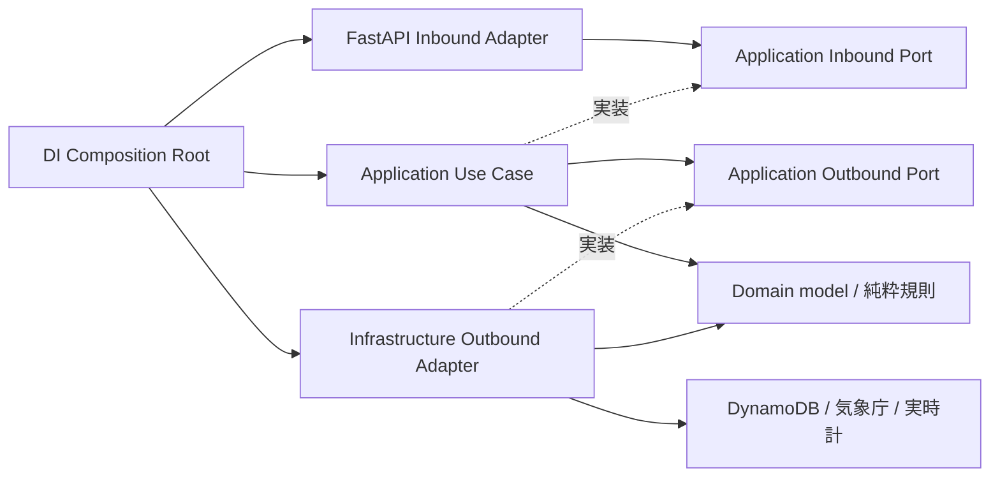

# バックエンドのPort／Adapter設計

エンジニア向けに、APIを維持してApplication所有のPortへ段階移行する設計を定義する。
設計の基準は2026-10-21の`eb5d792`、親Issueは[#137][parent]、設計Issueは[#153][design]。
設計追加後に#154〜#159で全経路を移行した。現在の配置と規則は以下の完成形を正本とし、移行前の棚卸しは当時の基準として残す。Port/Adapterの最終統合確認は#160で完了し、#244〜#251で想定内失敗も型付き結果へ移行した。
利用者向け仕様は[プロダクト仕様][product]、検証層は[テスト戦略][testing]を正本とする。

## 移行前の経路と依存（#153時点）

次図の実線は呼び出し、点線は型への依存を表す。各endpointはDIが公開する具象Use Case型の`Annotated` aliasをimportしている。



| 現行の所有物 | 利用元と問題 | 目標・移送する段階 |
| --- | --- | --- |
| `domain/station/repository.py`: `StationRepository` | stationと両temperature Use Caseが利用 | `application/station/ports/outbound/repository.py`、#156 |
| `domain/temperature/repository.py`: `TemperatureRepository` | 両temperature Use Caseが利用 | `application/temperature/ports/outbound/repository.py`、#157 |
| `domain/temperature/data_source.py`: `TemperatureDataSource` | FetchMonthUseCaseが利用 | `application/temperature/ports/outbound/data_source.py`、#158 |
| `domain/time/clock.py`: `Clock` | 両temperature Use Case、Repository、Guardが利用 | `application/shared/ports/outbound/clock.py`、#157 |
| `domain/temperature/fetch_guard.py`: `FetchGuard` / `FetchUnavailable` | FetchMonthUseCase、JMA Adapter、Guard、endpointが利用 | Outbound契約は`application/temperature/ports/outbound/fetch_guard.py`、#158。HTTPへ出すエラー契約はInbound側 |
| `di/container.py`: 4つの`*UseCaseDep` | endpointが具象Use Caseへ間接依存 | 各経路でPort型のPresentation依存関数へ置換、#159で旧alias撤去を確認 |
| Use Caseファイル内の`*Output` dataclass | Use Case具象と出力契約の所有が同じ | 経路ごとの`ports/inbound/`へ移送 |
| `main.py` / `handler.py`のseed・init呼び出し | mainはtable初期化とseed、Lambdaはimport時seed、Mangumはlifespan off | #159でDIの初期化関数へ委譲。回数・タイミング・起動経路は維持 |

純粋な`FetchFreshnessPolicy`、`FetchStatus`、`observation_time`、観測年月の検証、モデルはDomainに残す。
`InvalidTemperatureInput`は純粋な規則の例外としてDomainに残し、ApplicationがInboundの入力エラーへ変換する。
stationの未検出エラーも#156でstationのInbound契約へ定義し、現在の404とメッセージを維持する。
現在のtemperature endpointによるDomain例外importは#157/#158で除去する。
`/health`と`/api/hello`はI/OもUse Caseも持たない応答であり、空のInbound Portを作らない。

## 現在の所有と配置



呼び出しは`Inbound Adapter → Inbound Port ← Use Case → Outbound Port ← Outbound Adapter`で説明する。
Portの実装はPythonの構造的`Protocol`で表す。具象クラスの継承は必須にせず、DI providerのPort戻り値型とmypy strictで適合を検査する。
Application内では他機能のOutbound Portを利用できる。temperatureからstation Repositoryを利用する現行経路を維持する。

次は完成形の配置契約であり、空ディレクトリや未使用Protocolを先に作る指示ではない。

```text
app/
  application/
    prefecture/
      ports/inbound/list_prefecture.py  # ListPrefecturePort, PrefectureOutput
      list_prefecture_use_case.py
    station/
      ports/inbound/list_station.py     # ListStationPort, StationOutput
      ports/outbound/repository.py      # StationRepository
      list_station_use_case.py
    temperature/
      ports/inbound/get_temperature.py  # GetTemperaturePort, 取得専用Output群
      ports/inbound/fetch_month.py      # FetchMonthPort, 月別専用Output
      ports/outbound/repository.py      # TemperatureRepository
      ports/outbound/data_source.py     # TemperatureDataSource
      ports/outbound/fetch_guard.py     # FetchGuard, 成功・競合・喪失・DB障害の結果型
      get_temperature_use_case.py
      fetch_month_use_case.py
    shared/ports/outbound/clock.py      # Clock
  domain/                              # model, input_policy, fetch_freshness
  presentation/api/                    # endpoint別DTOとrouter
    shared/dependencies.py             # Port型付き依存関数、具象生成なし
  infrastructure/                      # repositories, scraper, DTO, time
  di/container.py                       # provider、依存登録、初期化と終了の配線
  main.py                               # ASGI起動、router/middleware登録
  handler.py                            # Lambda起動、Mangum
```

Inbound Portのメソッド名・同期／非同期・引数は現行Use Caseの公開メソッドを維持する。
`list_prefectures()`、`list_stations(prec_no=None)`、`get_temperature_data(station_id, end_year)`、
`async fetch_month(station_id, year, month)`を契約とし、単純な入力は標準型の引数で受ける。
複合入力が必要になるまではInput DTOを増やさない。OutputとPortを同じ契約モジュールに置き、Use Case具象のimportを不要にする。

### 禁止依存と例外

| import元 | 許可する内側の依存 | 禁止する依存 |
| --- | --- | --- |
| Domain | Domain、標準ライブラリ | Application、Presentation、Infrastructure、DI、設定、外部framework、外部I/O Protocol |
| Application | Application、Domain、標準ライブラリ（`asyncio`を含む） | Presentation、Infrastructure、DI、設定、FastAPI、Pydantic、boto3、httpx |
| Presentation | Application Inbound Portと公開入出力・結果型 | Use Case具象、Outbound Port、Domain、Infrastructure、DI、設定 |
| Infrastructure | Application Outbound Port、Domain、Infrastructure、外部SDKと設定 | Inbound Port、Use Case具象、Presentation、DI |
| DI | Port、Use Case具象、Adapter、設定、Presentation依存関数 | 業務判断・HTTP応答への変換 |

Presentation内のHTTPライブラリ、DTO、補助関数、router集約は許可する。`main`は起動配線として設定、Presentation、DIを参照できる。
`handler`はmain、DI、Mangumを参照できる。これらを業務処理や任意の具象接続の逃げ道にしない。
Infrastructure内のparser・DTO変換などの部品利用は許可する。外部clientの生成とlifecycle方針はDIへ渡し、Adapterは渡されたclient/factoryを使う。
既存の`JmaClient`の取得ごとの生成・`finally`でのcloseを保つfactory配線とし、close責務を消したりアプリ全体共有へ変えたりしない。

移行中だけ、表の未移行経路に残る既存のDomain Port、DI alias、Domain例外参照を許可する。
#154で例外を具体的なファイル／import単位で固定し、移行PRで削減する。新規違反をディレクトリ単位で免除しない。
移行前のAST検査の相対import解決とProtocol配置の不足は#154で解消した。現在は全import移行例外・Domain Protocol例外が0である。

### 入出力と結果の変換

- Inbound AdapterはHTTPのpath/queryを標準型へ検証し、Portへ渡す。ApplicationにFastAPIやPydanticを持ち込まない。
- Outbound AdapterはDynamoDB Item、HTMLなどをInfrastructure専用DTOで検証し、Domainモデルへ変換して返す。Portへ外部DTOを返さない。
- Use CaseはDomainモデルをユースケース専用Output dataclassへ明示変換する。OutputフィールドにもDomainモデルを公開しない。
- Inbound AdapterはOutputをendpoint専用のstrict Pydantic Responseへ明示変換する。日付、null、フィールド名、HTTP応答は維持する。
- Domain/Outboundの結果値はUse Caseで専用のInbound結果へ明示変換し、未検出・期間不正・DB障害・上流不能を区別する。旧独自例外と暫定変換は存在しない。
- HTTPへの対応はAdapterが行い、入力不正422、未検出404、取得不可503と`Retry-After: 5`、予期しない失敗500の既存契約を維持する。内部例外の詳細を新たに公開しない。

### Composition Rootとテスト差し替え

Presentation内の依存関数はInbound Portを戻り値に持ち、未登録時は明示的な構成エラーを起こす。
endpointは`Annotated[ListStationPort, Depends(...)]`のようにその関数を参照する。DIの具象型aliasを使わない。
DIは具象生成providerを用意し、FastAPI appのdependency overrideへ依存関数とproviderの対応を登録する。
mainがapp作成時に登録を呼び、Lambdaでも同じappの登録を利用する。Applicationはこの登録方式を知らない。
グローバル500 handlerのResponse DTO変換はPresentationの補助関数が所有し、mainにはhandlerの登録だけを置く。ログと応答本文は維持する。
テストは同じPresentation依存関数をPort準拠fakeに差し替え、実施後にoverrideを復元する。DI具象providerを差し替え続けるfixtureは移行経路ごとに更新する。

ClockはUTC壁時計と単調増加時計を区別する。FetchGuardのlease取得・所有確認・試行間隔・releaseの責務を維持する。
同一取得でUse CaseとJMA Adapterが同じGuardを共有する配線を維持し、移送時に別instanceを作らない。

## 移行順と各マージ時点の状態

各段階は独立したPRで検証し、人のレビュー・マージ後の最新mainから次へ進む。
Domain Portの旧パスを全利用元・テストと同時に移送し、旧パス再exportによる恒久的な互換層を作らない。

| Issue | 変更とマージ時点の状態 | 維持を確認するもの |
| --- | --- | --- |
| #153 | 本設計、AGENTS、レビューガイド、READMEのみ。コードは現行のまま | 文書のリンク、実装との棚卸し整合 |
| #154 | 回帰テストとAST境界検査を準備。未移行の例外を固定 | 全公開API、相対／絶対importの負例、mypy、unit・integration |
| #155 | prefecture Inbound Port、Output移送、依存関数とDI登録の最小パターン。ほかは現行 | prefecture応答、既存ASGI/Lambda起動 |
| #156 | station Inbound/Outbound Port移行。temperature Use CaseもStationRepositoryの新importへ追従 | 全件／絞り込み、未検出、station DTO、DynamoDB契約 |
| #157 | temperature取得Inbound/Repository移行。Clockも全利用元ごと移送。fetch-monthの参照も追従 | 50年範囲、日付・空データ、未検出、入力不正、時刻と鮮度 |
| #158 | fetch-month Inbound/Data Source/Guard移行。Domainの外部I/O Protocolを解消 | キャッシュ、再取得、保存、lease、retry、budget、エラー契約 |
| #159 | DI/main/handlerの配線・client lifecycleを仕上げ、旧aliasと移行例外を撤去 | host UvicornとLambda/Mangum、初期化とtest override |
| #160 | 最新mainで最終統合確認、文書の現状記述を完成形へ更新 | 全API実HTTP、import負例、required checks、Browser Smoke、開発/Lambda image smoke |

#155〜#158の各PRで移行対象のUse Case・Adapterを接続するDIも同時に更新し、#159まで壊れた中間状態を残さない。
#158までにJMA Adapterのclient/factory注入を配線し、#159では残存する具象接続を全体検索する。
各経路の移行時にunit・integration・DTO・境界テストを更新し、backendのformat → import sort → lint → mypy strict → pytestを実行する。
Browser Smokeは固定API応答による画面回帰、host/image smokeは実行経路の確認として別々に扱う。
最終検証で対象commit、環境、結果と未確認範囲を#160へ記録する。本番デプロイは対象外である。

## 移行中の検査の運用（#154）

`backend/tests/layer_rules.py`は目標構成のimport規則を定義し、`test_layer_boundaries.py`が実appツリーへ適用する。
絶対import、兄弟層への相対import、`from . import ...`、`__init__.py`、alias、TYPE_CHECKING内を含む静的importをASTで解決する。
動的importや実行時の具象生成までは保証しない。具象接続とlifecycleは移行PRのレビュー・#159の検索・#160の起動検証で確認する。

- `MIGRATION_EXCEPTIONS`は#154開始時の既存違反15組を「ファイルとimport先」で固定する。新規違反と、解消済みなのに残った例外の両方を失敗にする。
- `DOMAIN_PROTOCOL_EXCEPTIONS`は#154開始時の5つのDomain Protocol定義を固定し、別名や修飾名でのProtocol追加も検出する。
- 各移行PRでは経路のコード・テストと同時に対応する例外だけを削除する。例外一覧を現物から再生成して新規違反を容認しない。
- `application/<feature>/ports/`の契約クラスはUse Case/Service命名検査の対象外とし、Port配置と依存方向で検査する。Use Case自身の単一公開メソッド検査は維持する。
- `test_layer_rule_guards.py`は一時Pythonファイルへの禁止import配置と正例を自動検証する。appツリーへの絶対／相対禁止import配置でも境界pytestが終了コード1となり、除去後に成功することを#154で確認した。

API回帰の基準は`backend/integration_tests/api/`に置く。外部気象取得だけをfakeへ置換し、FastAPI、Use Case、DynamoDB RepositoryとDynamoDB Localを通す。

| 経路 | 現行テストと#154で固定する契約 |
| --- | --- |
| health / hello | 成功時の正確な本文 |
| prefectures | 61件、公開フィールド、型、東京都の名称 |
| stations | 全件と絞り込み、正確な公開フィールド・値、未検出404、型不正422 |
| temperature | 空・保存済みデータ、50年窓、最古年と次区間なし、日付・null、未検出404、観測年／HTTP入力不正422 |
| fetch-month | 正確な取得応答、キャッシュ、保存副作用、入力不正／未検出、上流RuntimeError/TimeoutErrorの503・Retry-After、予期しないOSErrorの500 |

上流失敗時は内部メッセージを応答へ出さず、取得済みログを残さず、lease解放後に再試行が成功することも検査する。
既存のunit・DTO・lease検査を維持し、#154はアプリケーションコードやAPI仕様を変更しない。

## prefecture移行の最小パターン（#155）

prefecture一覧では以下の構成を実装した。station・temperatureは移行前の経路を維持する。

1. `application/prefecture/ports/inbound/list_prefecture.py`が`ListPrefecturePort`と`PrefectureOutput`を所有する。メソッドは引数なしの`list_prefectures()`で、未使用のInput DTOやOutbound Portは作らない。
2. `ListPrefectureUseCase`は契約モジュールのOutputを返す。構造的Protocolへの適合はDI providerの`ListPrefecturePort`戻り値型とmypy strictで確認する。
3. `presentation/api/shared/dependencies.py`の`get_prefecture_port()`はPortを返す依存関数で、未登録なら構成エラーを送出する。
4. endpointは`Annotated[ListPrefecturePort, Depends(get_prefecture_port)]`で受け、専用のstrict `PrefectureResponse`へ明示変換する。具象Use Case・DIをimportしない。
5. `di/container.py`の`register_dependencies(app)`が依存関数とproviderを登録する。mainはapp作成直後に呼ぶので、lifespanを使わないLambda/Mangumにも同じ配線が適用される。
6. テストはPresentationの依存関数をPort準拠fakeへ差し替える。共有appのoverrideとlifespanを変更するfixture・テストは、終了時に保存した元の状態を復元する。登録全体の消去で本来のDI配線を失わない。

prefectureの旧具象型aliasを削除し、対応するimport移行例外1組を除去した。残る例外はほかの経路を移行するときに減らす。
unitではカタログ・順序、空／複数要素のPort差し替え、実provider登録、未登録エラー、Lambdaのlifespan off経路を検証する。
integrationでは既存の61件・フィールド・東京都の応答契約を維持する。

## station経路の移行（#156）

- `application/station/ports/inbound/list_station.py`が`ListStationPort`、`StationOutput`と`PrefectureNotFound`を所有する。単純な任意の地域番号は引数のまま受け、未使用Input DTOは作らない。
- `ListStationUseCase`はApplication所有の`StationRepository`からDomainモデルを受け、専用Outputへ変換する。地域に地点がないときはInboundの`PrefectureNotFound("Prefecture not found")`を送出する。
- station endpointは`get_station_port()`を通じてPortを受ける。既存のValueErrorから404への変換とResponse DTOのstrict検証を維持し、APIのエラー契約を広げない。
- Repository Protocolは`domain/station/repository.py`から`application/station/ports/outbound/repository.py`へ移送した。temperatureの両Use CaseとDIも新しい契約を参照し、旧パスや再exportを残さない。
- DynamoDB Adapterのクエリ・scan・ソート・DTO変換は変更しない。構造的Protocol適合をDI providerとRepositoryテストfixtureのPort型で検査する。
- DIはstationのInbound Port providerを登録し、具象型aliasを撤去した。旧import例外2組とDomain Protocol定義例外1件を除去する。

unitではDomainから専用Outputへの変換、全件・絞り込み・空カタログ・未検出・null値とPort差し替えを確認する。
DynamoDB Localの既存API回帰は、station全件／地域絞り込み、公開フィールドと404/422、station契約を共有するtemperatureの両経路を確認する。
prefectureの固定カタログのDomain移送は[別Issue][prefecture-domain]で扱い、#156では変更しない。

## temperature取得経路の移行（#157）

取得用Inbound Portと3つの専用Outputを`application/temperature/ports/inbound/get_temperature.py`へ移した。
TemperatureRepositoryとClockをApplicationのOutboundへ移し、月別取得・DynamoDB Adapter・Guardも参照先を更新した。
純粋なDomain入力例外はUse CaseでInboundの入力例外へ変換し、HTTPの422/404・メッセージ・50年窓・空データを維持する。
DIが`get_temperature_port`を登録し、旧具象aliasと対応する移行例外を除去した。月別取得のInboundとData Source/Guardは#158で扱う。

## 月別取得経路の移行（#158）

FetchMonthPortと専用Output、Data Source/FetchGuardをApplicationへ移送し、Domainの外部I/O Protocolを解消した。
Use Caseの公開境界で純粋な入力例外とOutboundの取得不可をInbound例外へ変換し、422/404/503とRetry-Afterを維持する。
JMA AdapterはDIからclient factoryを受け、取得ごとに生成してfinallyでcloseする。Guardは同一リクエストのDIキャッシュでUse Caseとclientに共有する。
HTTP試行間隔・retry・25秒の取得予算・lease・取得ログの順序は変更していない。失敗・キャンセル時のcloseと既存API回帰を検証した。

## Composition Rootの整理（#159）

全Inbound PortはDIでproviderへ接続し、起動時に登録する。具象Use Case・Adapter・JMA clientの生成は`di/container.py`へ集約した。
`di/lifecycle.py`はホストのtable初期化→seedと、Lambdaのcold start seedを所有する。初期化の回数・順序とLambdaのlifespan offを維持する。
500応答のDTO変換はPresentationの例外ハンドラへ移し、mainは登録だけを行う。main/handlerのInfrastructure直参照と移行例外を解消した。
ASTのimport検査に加え、DI外でのUse Case/Adapter生成を検出し、絶対・相対・別名の負例を確認する。動的生成は静的検査の対象外であり、レビューと実行経路検査を併用する。

## 統合検証（#160）

コードの基準は#159マージ後の`e4c7191`。クリーンなworktreeでPython 3.14.8とlocked依存を再現し、静的検査・mypy strict・unit187件・DynamoDB Local integration45件を確認した。
全5 APIを実UvicornとLambda/Mangumで確認し、月別取得は実client/parser/lease/保存経路を使い、気象庁HTTPだけを固定応答へ置換した。
絶対・相対importとDI外生成の負例で実pytestが失敗し、除去後の境界関連64件が成功した。
開発用Linux/amd64 imageとLambda imageのsmoke、production静的配信のBrowser Smoke4件も確認した。
実AWS・実気象庁への通信・本番デプロイは検証対象外であり、本番確認を代替しない。commit、環境、詳細な結果は[検証Issue][verification]に記録する。

## 型付き結果の契約（#244）

#245の設計基準は`523a290`。以下は#246〜#251で移行を完了した現在の契約である。#153〜#160の経緯に残る例外方式は当時の記録であり、現在の実装方針ではない。
内部の想定内失敗は原則frozen dataclassとUnionで返し、呼び出し側は`match`する。必要な網羅分岐は最後を`case unreachable: assert_never(unreachable)`とし、mypy strictで追加型の処理漏れを検出する。
汎用Resultライブラリ・外部framework型は導入しない。単純なNone/bool/空配列で障害を表さず、成功と失敗の意味を型で区別する。

### Port別の所有と結果

| 所有する境界 | 操作 | 成功 | 想定内の失敗 |
| --- | --- | --- | --- |
| station Outbound Repository | get_all / get_by_prec_no | StationsRead(stations)。空も成功 | StationStorageUnavailable |
| station Outbound Repository | get_by_id | StationFound(station) | StationMissing / StationStorageUnavailable |
| temperature Outbound Repository | range read | TemperaturesRead(records)。空も成功 | TemperatureStorageUnavailable |
| temperature Outbound Repository | fetched-month read | FetchedMonthsRead(months)。空も成功 | TemperatureStorageUnavailable |
| temperature Outbound Repository | bulk write / fetch-log write | TemperatureWriteSucceeded | TemperatureStorageUnavailable |
| station Inbound | list_stations | StationListResult(stations)。全件空は成功 | ListStationNotFound / ListStationStorageUnavailable |
| temperature取得 Inbound | get_temperature_data | GetTemperatureDataOutput | GetTemperatureNotFound / GetTemperatureInvalidPeriod(detail) / GetTemperatureStorageUnavailable |
| Domain入力規則 | year / month validate | ObservationPeriodValid | InvalidObservationPeriod(detail) |
| FetchGuard Outbound | acquire/check/before_attempt/release | GuardSucceeded | LeaseBusy / LeaseLost / GuardStorageUnavailable（操作ごとのUnionで必要な型だけ） |
| Data Source Outbound | fetch_daily_temperatures | TemperaturesFetched(records)。空も成功 | TemperatureSourceUnavailable / TemperatureSourceStorageUnavailable |
| 月別取得 Inbound | fetch_month | FetchMonthResult(records)。空も成功 | FetchMonthNotFound / FetchMonthInvalidPeriod(detail) / FetchMonthStorageUnavailable / FetchMonthUnavailable |

結果型は利用するPortのモジュールが所有する。Repository同一Port内の障害型は共有できるが、Outboundの障害型をそのままInboundやHTTPへ公開しない。
ApplicationでDomain/Outbound結果をユースケース専用Inbound結果へ明示変換する。成功OutputもDomainモデルとHTTP DTOから分離する。
JMA client内部のページ結果とData Source結果も分け、HTTP本文・SDK例外・内部障害の詳細を外へ出さない。prefecture一覧とClockには想定内失敗を新設しない。

### 外部互換性と優先順位

| 内部の結果/事象 | HTTP応答 |
| --- | --- |
| 成功 | 既存200 body、並び順・null・metadata・50年窓を維持 |
| station全件の成功空 | 200の空配列 |
| 指定地域にstationがない | 404 `{"detail":"Prefecture not found"}` |
| 指定station未検出 | 404 `{"detail":"Station <id> not found"}` |
| Domain観測年不正 | 422 `{"detail":"year outside observation range"}` |
| Domain観測月不正 | 422 `{"detail":"month outside observation range"}` |
| DB/Guard永続化不能 | 500 `{"detail":"Internal server error"}` |
| 上流取得不能、lease競合/喪失、月別取得予算超過 | 503 `{"detail":"Temporarily unavailable"}`、`Retry-After: 5` |
| 想定外の例外 | 既存共通handlerの汎用500。ログの情報境界を維持 |

HTTP Adapterは想定内失敗でHTTPExceptionをraiseせずJSONResponse等を返す。FastAPIのpath/query型検証（422のlist detail）とCORSのRetry-After公開は維持する。
入力の優先順はHTTP型検証→station参照→Domain観測年→月→cache/外部取得。DBでstationを参照できなければ500を返し、未検出404や期間不正422へ読み替えない。
metadata・空取得・cache鮮度を変更しない。全件空は成功、地域絞り込みの空は従来どおり404とする。

### 外部例外の分類

- Repository/GuardのDynamoDBではClientErrorの`ProvisionedThroughputExceededException`、`ThrottlingException`、`RequestLimitExceeded`、`InternalServerError`、`ServiceUnavailable`だけを永続化不能へ変換する。
- botocoreの`EndpointConnectionError`、`ConnectTimeoutError`、`ReadTimeoutError`、`ConnectionClosedError`も永続化不能にする。エラーコード以外のSDK例外やClientError全体を丸めない。
- `ResourceNotFoundException`、`AccessDeniedException`、認証/設定不備、ParamValidationErrorは想定外のまま共通500へ到達させる。未知のClientErrorも再送出する。
- ConditionalCheckFailedExceptionはGuardの操作に応じた値へ変換する。acquire競合はLeaseBusy、所有者/期限/欠落はLeaseLost。release時の条件不一致はすでに所有していないので成功として扱い、別所有者のleaseを触らない。
- 壊れたDynamoDB DTOやlease DTOのPydantic ValidationError、parserの契約違反は破損/不具合として例外を維持する。欠落leaseと破損leaseを区別する。
- JMAのHTTP status失敗、httpxのRequestError、1試行TimeoutErrorは既存3試行のretry対象とし、試行上限で上流取得不能を返す。InvalidURL/UnsupportedProtocol等の設定・利用契約違反は業務結果にしない。
- before_attemptはGuardの結果を返す。競合/喪失/DB失敗をmatchし、次の上流試行へ進まずData Sourceへ対応する値を返す。GuardのDB失敗は上流503へ丸めず500へ変換する。
- 想定内I/O失敗はAdapterで安全なイベント名をログへ残す。内部例外/SDK payload/SQL等を結果やHTTP本文へ含めず、ユーザー入力・token等をログへ追加しない。

### 取得保護とcleanup

最大3試行・1試行8秒・試行間隔2秒以上・取得予算25秒を維持する。予算のasyncio TimeoutErrorだけを必要な境界で取得不能へ変換し、RuntimeErrorやException全体を取得不能へ丸めない。
cache再確認→取得→所有確認→データ保存→所有確認→fetch-logの順序を維持する。途中のDB/Guard失敗では後続を止め、fetch-logを書かない。
leaseを取得した経路は結果の成功/失敗・例外・キャンセルにかかわらずreleaseし、clientを生成した経路はcloseする。acquire未成功ではreleaseしない。

cleanupの優先順は次で固定する。
1. キャンセル/想定外例外が進行中なら、それを維持する。cleanupの二次障害は安全なログへ記録し、元の例外を隠さない。
2. 主処理が型付き失敗でcleanupも想定内失敗なら、主処理の失敗を維持して二次障害をログへ記録する。
3. 主処理が成功でreleaseが永続化不能なら500、closeが想定内I/O失敗なら上流503にする。
4. 主処理が値で完了した後の予期しないcleanup例外は汎用500へ到達させる。cleanupのためだけの例外捕捉を通常の業務失敗判定へ転用しない。

CancelledErrorを成功や業務エラーに変換しない。lease喪失後に新たな試行/書込みを開始せず、TTL削除に依存せず条件式で判定する。外部副作用の原子性やtransactionを新設する変更は含まない。

### 段階移行と暫定変換の撤去

| Issue | そのPRで動く中間状態と撤去担当 |
| --- | --- |
| #245 | 本契約だけを定義、実装変更なし |
| #246 | Repository全メソッドを結果化し、全Use Case/HTTP/Fakeを追従。Inboundへ専用DB失敗値を加え500を直接返す。未検出・期間不正・上流の旧例外は残す |
| #247 | station成功/未検出/DB失敗を直和型へ統一し、PrefectureNotFound例外とValueError/HTTPException変換を撤去 |
| #248 | 参照APIとDomain年検証を結果化。月検証は必要なら年結果を旧例外へ戻す暫定変換を置き、#250で撤去 |
| #249 | JMA/Guard/callbackを結果化。月別Applicationはmatchし、取得不能のみ旧Inbound例外へ戻す暫定変換を置き、#250で撤去。DB失敗はInbound DB失敗値へ変換 |
| #250 | 月別Inbound/Domain月検証を結果化し、残る独自例外/暫定raise/catchと広いRuntimeError捕捉を撤去 |
| #251 | API/保護/網羅性の回帰と、想定内例外の再混入を防ぐ限定検査。正当な外部境界・起動エラー・500 handler・timeout/cancel cleanupは許容 |

各PRで型検査・unit・integrationと変更境界の障害注入を行う。最後の検査Issueへ実装テストを先送りしない。
実装・HTTP変換では具体型のcaseを列挙し、型付き失敗の追加がassert_neverへ到達する負例も確認する。汎用catch-all・cast・type ignoreで分岐漏れを隠さない。

### 永続化結果の移行状態（#246）

Station/Temperature Repositoryの全操作は成功・未検出・想定内I/O障害を型付き値で返す。
各Use Caseはmatch/assert_neverで処理し、ユースケース専用の永続化不能を返す。HTTPはその値を直接汎用500へ変換する。
未検出・観測期間・上流の旧例外は#247〜#250で撤去済み。失敗コードの限定・全操作の障害注入と、月別途中失敗後の停止/lease解放を検証した。

### station結果の移行状態（#247）

station InboundはStationListResult・ListStationNotFound・ListStationStorageUnavailableのUnionを返す。
HTTPは具体型をmatchして200/404/500を直接返す。全件空は成功、指定地域空は404を維持する。
旧PrefectureNotFound例外、広いValueError捕捉、業務HTTPExceptionを撤去し、想定外ValueErrorは汎用500へ到達する回帰を確認した。

<!-- links -->
[parent]: https://github.com/nkoguchi-dev/heat-chronicle/issues/137
[design]: https://github.com/nkoguchi-dev/heat-chronicle/issues/153
[product]: ./specs/product.md
[testing]: ./TESTING_STRATEGY.md
[verification]: https://github.com/nkoguchi-dev/heat-chronicle/issues/160
[prefecture-domain]: https://github.com/nkoguchi-dev/heat-chronicle/issues/238
<!-- /links -->

### #248: キャッシュ気温参照の結果値

キャッシュ参照は成功・地点未検出・観測期間不正・永続化不能をInboundの専用結果で返す。年検証は純粋なDomain結果を返す。月別取得の旧例外への暫定変換は#250で撤去済み。想定外のValueErrorは共通500へ伝播する。metadata・50年範囲・地点確認後の期間判定は維持する。

### #249: JMA取得・共有lease・callbackの結果値

OutboundのDataSourceとGuard、試行前callbackは成功・上流不能・所有権喪失・競合・DB障害を専用結果で返す。JMA内部のHTML取得結果も明示的に変換する。DB障害を競合503へ変換せず、破損DTO・設定不備・想定外RuntimeErrorは例外のまま共通500へ伝播する。月別Inboundの上流不能例外への暫定変換は#250で撤去済み。

3試行・8秒・2秒以上の間隔・25秒予算・30秒leaseを維持する。解放/closeの想定内失敗は先行する失敗結果を保ち、成功後なら対応する失敗へ変える。想定外cleanupは通常500へ伝播するが、既に伝播中の例外・キャンセルを上書きしない。安全な操作名だけをログに残す。

### #250: 月別取得の結果値と暫定変換の撤去

月別InboundはFetchMonthResult・地点未検出・期間不正・永続化不能・取得不能のUnionを返し、HTTPはmatchからResponseを返す。Domainの年月検証も純粋な結果値とし、旧Inbound/Outbound/Domainの独自例外と暫定変換をすべて撤去した。asyncio timeoutだけを取得不能へ変換し、想定外RuntimeError/ValueErrorは共通500へ届く。

共有lease確保後の鮮度再確認、取得→所有権→保存→所有権→取得ログの順序を保持する。cleanupはその呼び出し自身で伝播中の例外/キャンセルだけを優先し、呼び出し元が処理中の例外に影響されない。取得失敗と解放失敗が重なった場合は一次結果を維持する。

### #251: 結果契約の回帰検査

`backend/tests/result_rules.py`はApplication/Portと観測期間規則での独自業務例外・ValueError送出・広い例外捕捉、および対象HTTP endpointでのHTTPException送出/importと広い捕捉を検出する。aliasと修飾名を含む静的ASTの限定検査であり、全raise禁止や動的コードの完全証明ではない。SDK/client例外、外部DTO validator、構成違反、共通500、asyncio timeout、元の例外を保つcleanupは許容する。検査自体の正負例を`test_result_rule_guards.py`で維持する。

実PortとDIのmypy strictに加え、Unionへ型を追加したときassert_neverで未処理型を検出する負例も実行する。API横断の成功/404/422/503/500・Retry-After/CORS、DB障害と上流障害、未知例外とcleanupの回帰をunit/integrationで検証する。frontend品質検査とBrowser Smokeも完了条件とし、本番デプロイ・実JMA負荷試験は含めない。地域固定カタログのDomain移送は#238で扱う。
